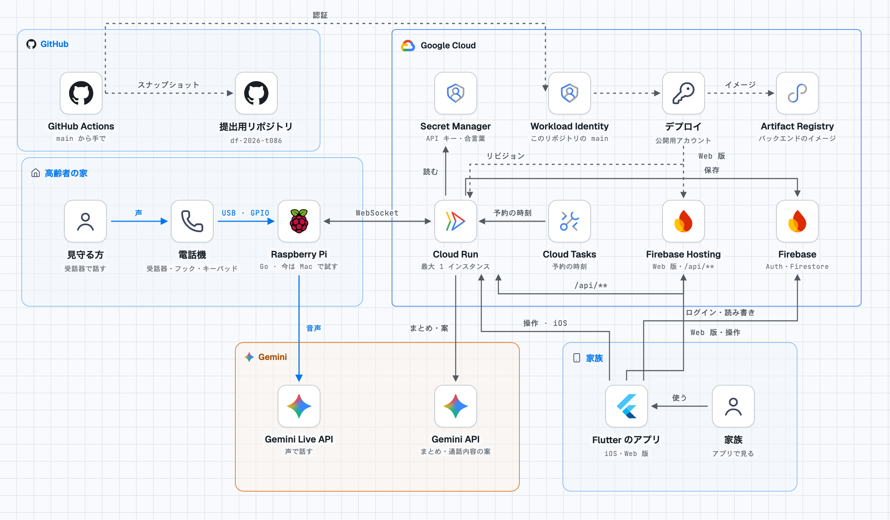

# かぞくAI

見守る方の家の電話機に AI が電話をかけ、話した様子を家族のアプリに届けるサービスです。

## プロジェクト概要

「かぞくAI」は、離れて暮らす高齢者の見守りや生活支援を行いたくても、仕事や家事などで十分な時間を確保できない家族の方たちの負担を軽減することを目的としたWebアプリです。高齢者は、使い慣れた固定電話に話しかける感覚でAIと自然に会話でき、日常生活のサポートを受けられます。一方、家族は管理者アプリを通じて会話履歴やその要約を確認することで、離れた場所からでも高齢者の様子を把握できます。これにより、高齢者の孤独感や操作負担の軽減と、家族による継続的な見守りの両立を目指しています。

## 解決する課題

### 対象ユーザー

- 離れて暮らす家族の支援を必要とする高齢者
- 高齢者の見守りや生活支援に負担を感じている家族

### 課題と根拠

現在、日本の総人口に占める65歳以上の割合は29.6%となっており、2070年には38.7%にまで増加すると推計されています。また、ライフエレメンツ株式会社の調査によると、77.0%が介護に不安や悩みを抱え、67.0%が仕事や家庭生活への影響を感じていることが明らかになっています。さらに、68.1%が見守りサービスの利用意向を示しており、高齢者の見守りに対する需要がますます高まっていくことが考えられます。

このような背景から、本プロジェクトでは、高齢者を支える家族の負担軽減と、高齢者自身が安心して生活できる環境の実現を解決すべき課題として設定しました。

### 既存手法との違い

| 観点 | 従来の見守りアプリ | かぞくAI |
| --- | --- | --- |
| プライバシー | カメラやGPSによるプライバシーの負担が大きい。 | 電話での会話内容のみがログとして残るため、カメラやGPSよりもプライバシーの負担が小さい。 |
| 使いやすさ | 設置、登録をするだけ。高齢者は何もしなくていい。 | 固定電話のように使える。管理者は会話のログから詳細な情報を得られる。 |
| 機能 | 高齢者の管理は家族。 | 高齢者の管理の一部はAIが代替。 |
| 見た目 | 家にカメラがあると、不信感が強い。 | 見慣れているため、親しみを持てる。 |

## 使い方

| 1. 電話機と同期する | 2. 電話をかける | 3. 様子を確かめる |
| --- | --- | --- |
| 電話機の受話器を上げて「＃」を押すと、6桁の認証コードを読み上げます。家族はそれをアプリに入力します。 | 家族はアプリから、今すぐ電話をかけるか、日時を決めて予約します。見守る方は、鳴った電話に出て話すだけです。 | 電話が終わると、AI が会話をまとめます。家族は今日の様子、通話記録、伝言への返答をアプリで確かめます。 |

## できること

- **伝言を届ける**: 家族が伝えたいことを書くと、AI が電話で話す言葉の案を作ります。家族は案を直してから電話をかけられます。
- **話し相手になる**: 伝言がないときも、AI が見守る方の話し相手として会話します。
- **予約電話**: 日時を決めておくと、その時刻に AI が電話をかけます。
- **今日の様子**: 会話から、食事、眠り、体調の様子をまとめて、家族のホームに出します。
- **通話記録**: 電話ごとのまとめと会話を、あとから見返せます。

## 提出情報

- 作品名: かぞくAI
- 公開アプリ: https://kazokuai.web.app
- 提出コード: 開発リポジトリの main のスナップショット（コミットメッセージに元のコミット ID があります）
- 開発リポジトリ: https://github.com/gesop0n/kazokuai
- 審査員用のアカウントは、別にお渡しします。見本の1週間分の電話と予約が入っています。

## 技術スタック

| 部分 | 使っているもの |
| --- | --- |
| 電話機 | 固定電話と Raspberry Pi。Go で受話器、フック、キーパッドを扱う |
| AI | Gemini Live API（電話の声）、Gemini API（会話のまとめと、話す言葉の案） |
| バックエンド | Go、Cloud Run |
| データと認証 | Firebase Authentication、Cloud Firestore |
| 予約電話 | Cloud Tasks |
| アプリ | Flutter（Web 版は Firebase Hosting、iOS 版） |
| インフラと公開 | Terraform、GitHub Actions、Workload Identity |

## アーキテクチャ図

<picture>
  <source media="(prefers-color-scheme: dark)" srcset="docs/architecture/kazokuai-dark.png">
  
</picture>

## ライセンス

[MIT License](LICENSE) です。
